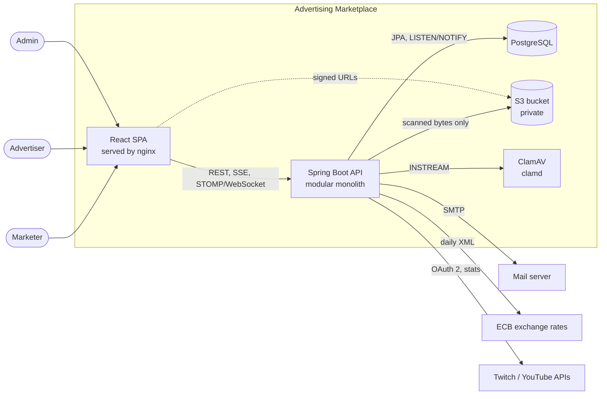
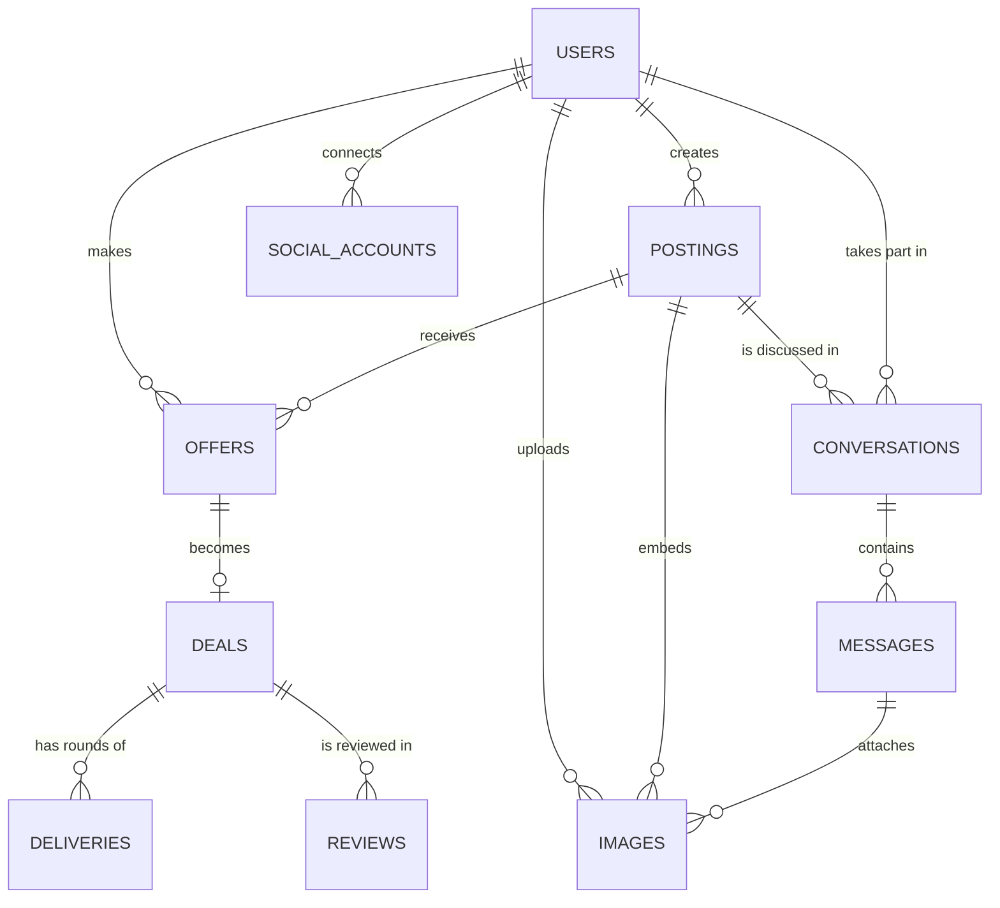
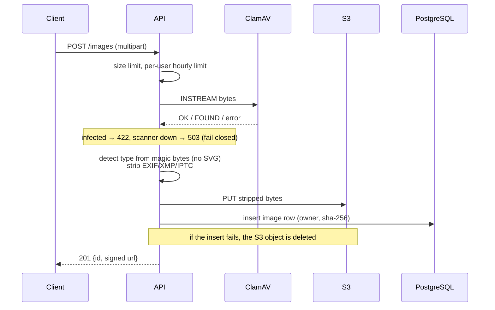
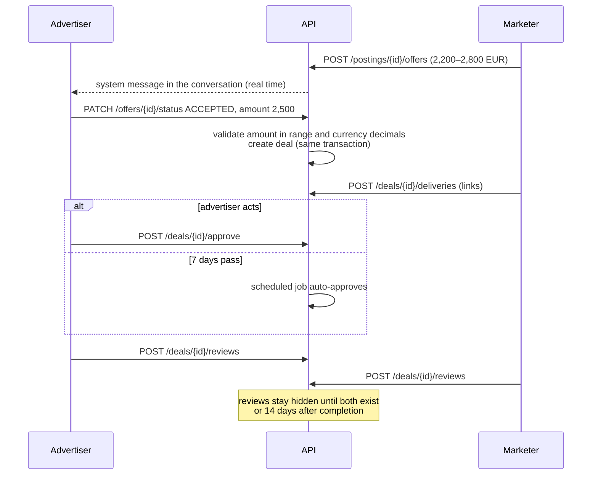
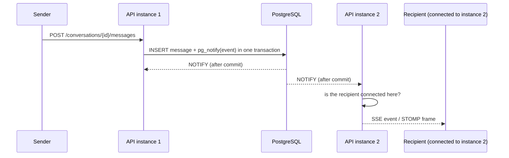
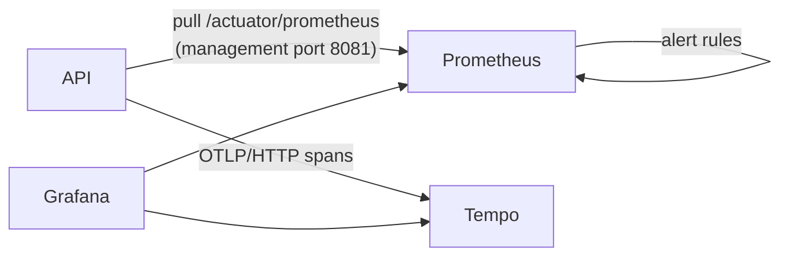

# Architecture

Advertising Marketplace connects **marketers** (people with an audience: streamers, YouTubers, creators) with
**advertisers** who want to reach that audience. Either side publishes postings, the other side sends offers,
they negotiate in a conversation, and an accepted offer becomes a **deal** that is delivered, approved and
reviewed.

This document describes how the system is built and why. The individual decisions are recorded as ADRs in
[`docs/adr`](adr/).

## System context



| Component | Technology | Role |
|-----------|------------|------|
| SPA | React 19, TypeScript, TanStack Query, Vite | All UI. Talks only to the API (and to S3 through signed URLs for images). |
| API | Java 21, Spring Boot 4, Hibernate 7 | Business logic, auth, real time, scheduled jobs. Stateless apart from open SSE/WebSocket connections. |
| PostgreSQL 17 | Flyway migrations | System of record, and the event bus for real-time fan-out (`LISTEN/NOTIFY`). |
| S3 | AWS SDK v2 (S3Mock locally) | Image storage. The bucket is private; reads go through 1-hour signed URLs. |
| ClamAV | clamd over TCP | Virus scan of every upload before it is stored. |
| Observability | Micrometer, OpenTelemetry, Prometheus, Tempo, Grafana | Metrics, traces, dashboard and alerts. See [Observability](#observability). |

## Backend structure

The backend is a **modular monolith** ([ADR 0001](adr/0001-modular-monolith.md)): one deployable, with
packages split by business capability rather than by technical layer.

```
com.advertisingmarketplace
├── user          users, roles, profile data
├── auth          signup/login, JWT access tokens, refresh tokens, login throttling
├── security      filter chains, CORS, problem-detail auth errors, management-port access
├── posting       postings, search and filtering, embedded images
├── offer         offers on postings
├── deal          deals and deliveries (accepted offer → completion)
├── review        double-blind reviews and rating summaries
├── profile       public profile read model
├── social        Twitch/YouTube OAuth, encrypted tokens, audience sync
├── messaging     conversations, messages, real time, email notifications, blocking/reporting
├── image         upload pipeline: scan → detect type → strip metadata → S3
└── common        money and exchange rates, validation, errors, observability
```

Each package owns its entities, repository, service and controller. A package uses another one through its
service (for example `OfferService` → `DealService.startFromOffer`, `DealService` →
`MessagingService.recordDealEvent`). The one shared table that crosses packages without a service is `users`.

Conventions that hold everywhere:

- Controllers are thin: they map HTTP to a service call and back. Authorization that depends on data
  (is this user a participant of this deal?) lives in the service, next to the data.
- Services are `@Transactional(readOnly = true)` by default; writes opt in.
- Errors are subclasses of `ApiException` carrying their HTTP status, rendered as RFC 9457 problem details
  with a `traceId`.
- Entities never leave the service layer; responses are records built from them.
- The schema is owned by Flyway; Hibernate only validates it.

## Domain model



Lifecycles:

```
Posting   DRAFT ──publish──▶ OPEN ◀──reopen/close──▶ CLOSED
Offer     PENDING ──▶ ACCEPTED | REJECTED | WITHDRAWN          (revisable while PENDING)
Deal      IN_PROGRESS ──deliver──▶ DELIVERED ──approve / auto-approve after 7 days──▶ COMPLETED
               ▲                        │
               └────request changes─────┘
          IN_PROGRESS ──cancel──▶ CANCELLED
```

Some data is deliberately copied rather than joined:

- A **deal** stores the agreed amount, currency and posting title, so it is unaffected by later edits to
  the posting or the deletion of the offer.
- A **posting** stores its pay range converted to EUR, recomputed when rates change, so filtering and
  sorting across currencies is a plain indexed query ([ADR 0007](adr/0007-eur-normalised-pay.md)).

## Key flows

### Image upload



Nothing reaches the bucket unless the scan completed and was clean ([ADR 0004](adr/0004-scan-before-store.md)).
Uploads that are never embedded are deleted by an hourly cleanup job after 24 hours.

### From offer to review



### Real-time messaging across instances



Because `NOTIFY` is transactional, an event is only delivered if the message was committed. Every instance
listens on one dedicated connection and pushes to its own clients, so the system scales horizontally with
no message broker ([ADR 0002](adr/0002-postgres-listen-notify.md)).

## Security

Summary; details and rationale in the README's *Security model* and ADRs 0003, 0004 and 0005.

| Concern | Approach |
|---------|----------|
| Authentication | 15-minute HS256 JWT access token in memory; 30-day opaque refresh token in an `HttpOnly`, `SameSite=Strict` cookie, rotated on every use, with reuse detection that revokes all sessions ([ADR 0003](adr/0003-refresh-token-cookie.md)). |
| CSRF | Cookie endpoints also require an `X-Requested-With` header, which cross-site forms can't send. Everything else uses the bearer header. |
| Passwords | BCrypt through `DelegatingPasswordEncoder`; equal-time responses for unknown emails. |
| Brute force | Failure counters in PostgreSQL per email+IP (5/15 min) and per email (20/15 min) ([ADR 0005](adr/0005-login-throttling-in-postgres.md)). |
| Authorization | Roles from user type; data-level checks in services (participant, creator, owner). |
| Uploads | Scan before store, magic-byte type detection, metadata stripping, private bucket, rate limit ([ADR 0004](adr/0004-scan-before-store.md)). |
| Third-party tokens | Twitch/YouTube refresh tokens encrypted with AES-256-GCM; OAuth `state` is a signed, user-bound, 10-minute JWT. |
| Abuse | Message rate limit, blocking, reporting with admin review, optional contact masking. |
| Operations endpoints | Actuator lives on a separate management port that is never exposed publicly ([ADR 0009](adr/0009-observability.md)). |

## Observability



- **Metrics.** Micrometer with a Prometheus registry. Besides HTTP, JVM, Hikari and scheduled-job metrics,
  the app publishes business counters from one place, `MarketplaceMetrics`: logins by outcome, uploads by
  outcome, offers, deal lifecycle events, messages, reviews, audience syncs, exchange-rate refreshes. Live
  gauges cover open SSE streams and exchange-rate age. Counters for transactional events are incremented
  **after commit**, so rolled-back work isn't counted.
- **Traces.** Micrometer Observation bridged to OpenTelemetry, exported over OTLP to Tempo when
  `TRACING_EXPORT_ENABLED=true`. HTTP requests, Spring Security, scheduled jobs, the ClamAV scan, the S3 put
  and the ECB fetch are spans. HTTP latency histograms carry **exemplars**, so a slow point on a Grafana graph
  links straight to its trace.
- **Correlation.** Every response has an `X-Trace-Id` header, and every problem-detail error body has a
  `traceId`. Log lines include the trace and span ids. A user's bug report therefore leads to the exact trace
  and log lines. `LOGGING_STRUCTURED_FORMAT_CONSOLE=ecs` switches logs to JSON for a log pipeline.
- **Dashboard and alerts.** `docker compose --profile observability up` starts Prometheus, Tempo and Grafana
  with a provisioned dashboard and alert rules (`observability/`). Alerts cover availability, error rate,
  latency, database pool saturation, the virus scanner, stale exchange rates, failing jobs and syncs, and
  login-failure spikes.

## Testing strategy

| Level | Tool | What it covers |
|-------|------|----------------|
| Unit (backend) | JUnit 5, Mockito, AssertJ | Service rules, state machines, money rounding, metadata stripping, token crypto, metrics semantics. |
| Web slice | `@WebMvcTest` | Request validation, status codes, security rules per endpoint, cookie handling. |
| Integration | `@SpringBootTest` + Testcontainers | Real PostgreSQL, ClamAV, S3Mock and Mailpit, plus fake ECB and OAuth servers. Flyway migrations, queries, transactions, `LISTEN/NOTIFY`, SSE/STOMP, the upload pipeline with the EICAR test file ([ADR 0010](adr/0010-testcontainers.md)). |
| Frontend unit | Vitest, Testing Library | Formatting, the API client's refresh logic, components, auth pages. |
| End-to-end | Playwright | Two browsers negotiating live, accepting with an amount, delivering, approving, double-blind reviews, cookie session across reloads. |

CI ([`.github/workflows/ci.yml`](../.github/workflows/ci.yml)) runs all of the above on every pull request,
then starts the built jar against real services for the end-to-end job and checks that business metrics were
exported. Docker images are built to catch Dockerfile breakage.

## Scaling and failure modes

What happens when you run several instances behind a load balancer:

| Area | Behaviour with N instances |
|------|----------------------------|
| HTTP API | Stateless (JWT), scales horizontally. |
| Real time | Works: each instance `LISTEN`s and serves its own connections. Clients need sticky routing only for the lifetime of one WebSocket/SSE connection, which any load balancer provides. |
| Login throttling | Shared through PostgreSQL. |
| Email notifications | Safe: rows are claimed with `FOR UPDATE SKIP LOCKED`. |
| Deal auto-approval | Safe: each deal is completed in its own transaction, the status is re-checked, and `@Version` rejects the second writer, which then skips the deal. |
| Exchange rates, image cleanup, token cleanup | Run on every instance. Idempotent, so duplicates are wasted work, not wrong results. |
| Audience sync | Runs on every instance, so provider APIs are called N times. Harmless for correctness but wasteful against quotas. **Fix before scaling out:** add ShedLock (or a `pg_try_advisory_lock`) around scheduled jobs. |

Single points of failure and their effect:

- **PostgreSQL down**: the app is down (readiness fails).
- **ClamAV down**: uploads fail with `503` by design; everything else works. Alerted.
- **S3 down**: uploads fail; existing image URLs fail. Everything else works.
- **ECB unreachable**: the previous rates stay in use; alerted after 4 days.
- **Twitch/YouTube down**: sync is retried the next day; connected stats stay at their last value.

Known limits worth stating plainly:

- `NOTIFY` payloads are limited to 8 KB, so events carry ids and recipients are sent a freshly loaded message.
  Under very high message volume, a dedicated broker would take over; the `ConversationEventPublisher`
  interface is the seam for that.
- No payments. The deal records the agreed amount; holding and releasing funds (for example Stripe Connect)
  is the obvious next step and would hook into the deal lifecycle at accept and complete.
- No full-text search; posting search is by filters only.

## Local topology

| Port | Service |
|------|---------|
| 5173 | Vite dev server (proxies `/api` and `/ws` to 8080) |
| 3000 | Production frontend container (nginx) |
| 8080 | API |
| 8081 | Actuator: health, Prometheus, metrics (bound to localhost in compose) |
| 5432 | PostgreSQL |
| 9090 | S3Mock |
| 3310 | ClamAV |
| 8025 / 1025 | Mailpit UI / SMTP |
| 9091 | Prometheus (`observability` profile) |
| 3001 | Grafana (`observability` profile) |
| 4318 | Tempo OTLP/HTTP (`observability` profile) |
